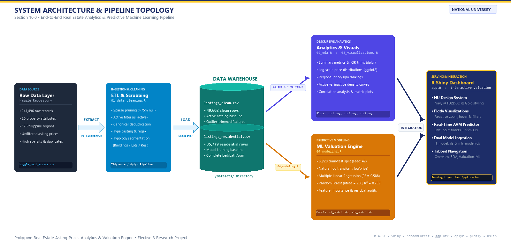
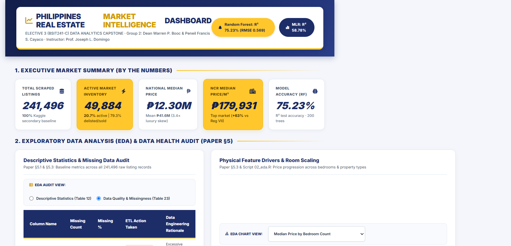

# Philippines Real Estate Market Analysis and Price Prediction Using R

[](https://www.r-project.org/)
[](https://shiny.posit.co/)
[](https://cran.r-project.org/package=randomForest)
[](https://national-u.edu.ph/)

> **Academic Capstone Project — BSIT241-C (Elective 3)**  
> **National University** • Academic Year: 2026 – 2027  
> **Authors:** Dean Warren P. Booc & Peneil Francis S. Cayaco  
> **Instructor:** Prof. Joseph L. Domingo  

---

## 📌 Project Overview

This data analytics capstone project investigates property asking price determinants across **241,496 secondary real estate listings** in the Philippines spanning 17 administrative regions. By transitioning from subjective intuition to empirical econometric modeling and machine learning, this project:

1. **Quantifies Real Estate Dynamics:** Dissects price skewness, geographic land density premiums, and physical property drivers.
2. **Implements Supervised Machine Learning:** Compares an interpretable baseline **Multiple Linear Regression (MLR)** model ($R^2 = 0.588$) against an ensemble **Random Forest Regression** model ($R^2 = 0.752$).
3. **Operationalizes Empirical Insights:** Deploys an interactive **R Shiny & Plotly Decision-Support Dashboard (`app.R`)** delivering real-time Automated Valuation Model (AVM) price estimates with 95% confidence intervals.

---

## 🏗️ System Architecture & Pipeline Topology

The end-to-end data pipeline is structured into five modular stages:



1. **Data Source:** Raw secondary scraping repository (241,496 records, 25 attributes) from Kaggle.
2. **ETL Scrubbing:** Filtering active listings (49,884, 20.7%), canonical deduplication, sparse column pruning (>75% null), and residential extraction.
3. **Data Warehouse:** Partitioned storage into clean catalogs (`listings_clean.csv`) and supervised modeling cohorts (`listings_residential.csv`).
4. **Parallel Computational Engines:** Descriptive analytics (`02_eda.R`, `03_visualizations.R`) and machine learning estimation (`04_modeling.R`).
5. **Interactive Serving Layer:** Live web application serving real-time algorithmic valuations via `app.R`.

---

## 📊 Key Findings & Empirical Results

| Metric / Dimension | Baseline Linear Model (MLR) | Random Forest Ensemble (200 Trees) | Empirical Interpretation |
| :--- | :---: | :---: | :--- |
| **Out-of-Sample $R^2$** | **0.5878 (58.8%)** | **0.7523 (75.2%)** | Random Forest captures compounding non-linear feature interactions with superior fidelity. |
| **Root Mean Squared Error (RMSE)** | **0.7345** | **0.5693** | Random Forest reduces predictive error dispersion by **>22.5%** on unseen test data ($N = 3,158$). |
| **Mean Absolute Error (MAE)** | **0.5429** | **0.4172** | Substantially tighter prediction clustering across all property price tiers. |
| **Floor Area ($\beta_{\text{sqm}}$)** | $+0.000152$ ($p < 0.001$) | Top Node Purity ($4,410.3$) | Primary physical scale determinant of residential value. |
| **Bathrooms ($\beta_{\text{baths}}$)** | $+0.4983$ ($p < 0.001$) | Ranked #2 in Node Purity | $+49.8\%$ value increase per bathroom; acts as a proxy for master en-suite layouts and luxury finishes. |
| **Bedrooms ($\beta_{\text{beds}}$)** | $+0.0871$ ($p < 0.001$) | $+9.10\%$ exact ($e^{0.0871} - 1$) | Statistically significant positive baseline contributor to living space. |
| **Property Typology (House)** | $-0.5666$ ($p < 0.001$) | $34.6\%$ %IncMSE (Rank #1) | **Condominium Price Paradox:** Condos command a $+43.3\%$ premium over houses of identical size due to prime urban CBD location concentration. |

---

## 🚀 Interactive Valuation Dashboard (R Shiny / Plotly)

The interactive dashboard (`app.R`) operationalizes empirical research into an end-to-end decision-support platform designed in the National University Navy (`#1D2D68`) and Gold (`#FFC72C`) theme.



### Key Dashboard Modules:
* **Executive Market KPI Summary:** Live counters for catalog scale, active inventory, national median price, and model accuracy.
* **Data Health & Attrition Audit:** Interactive toggle between descriptive statistics and the 6-stage ETL scrubbing funnel.
* **Spatial & Typology Distributions:** Interactive Plotly boxplots and regional price-per-square-meter rankings.
* **Market Turnover Velocity:** Density distributions comparing active vs. inactive listing turnover cycles.
* **Live Algorithmic AVM Predictor:** Instant property valuation calculated dynamically via the trained Random Forest and MLR models based on user inputs.

---

## 📁 Repository Structure

```text
├── app.R                             # Interactive R Shiny / Plotly Valuation Dashboard
├── run_all.R                         # One-click master pipeline execution script
├── Elective3 Interim2.Rproj           # RStudio Project Workspace File
├── .gitignore                        # Git exclusion rules (caches, temp locks)
├── README.md                         # Project documentation and reproduction guide
│
├── Datasets/                         # Data storage directory
│   ├── listings.csv                  # Raw Kaggle dataset (241,496 rows)
│   ├── listings_clean.csv            # Cleaned active deduplicated catalog (49,602 rows)
│   ├── listings_buildings.csv        # Building floor-area subset (sqm > 0; 43,884 rows)
│   └── listings_residential.csv      # Complete modeling cohort (15,790 rows)
│
├── Scripts/                          # Modular analytical execution scripts
│   ├── 01_data_cleaning.R            # 6-stage ETL pipeline and scrubbing protocols
│   ├── 02_eda.R                      # Descriptive statistics and correlation analysis
│   ├── 03_visualizations.R           # ggplot2 figures (Figures 1, 2, and 3)
│   ├── 04_modeling.R                 # MLR and Random Forest training, evaluation, variable importance
│   └── plot_model_diagnostics.R      # Side-by-side actual vs. predicted diagnostic plot (Figure 4)
│
├── Models/                           # Serialized machine learning models
│   ├── mlr_model.rds                 # Trained Multiple Linear Regression model
│   └── rf_model.rds                  # Trained Random Forest ensemble model (200 trees)
│
├── Plots/                            # High-resolution publication figures & diagram assets
│   ├── model_actual_vs_predicted.png # Figure 4: Model diagnostics scatter plot
│   ├── rf_variable_importance.png    # Figure 5: Random Forest %IncMSE & Node Purity plot
│   ├── system_architecture_pipeline.png # Figure 6: 300 DPI architecture topology
│   ├── viz1.png                      # Figure 1: Property type log-price boxplot
│   ├── viz2.png                      # Figure 2: Top 10 regions by median price/m²
│   └── viz3.png                      # Figure 3: Active vs. inactive turnover density
│
├── Documents/                        # Academic project documentation
│   ├── ELLECTIVE_INTERIM2_FINAL_v2.docx # Final capstone research paper
│   └── BSIT_Data_Analytics_Rubric.xlsx  # Formal evaluation rubric
│
└── Presentations/                    # Capstone defense presentation deck
    └── ElectivePPT.pptx              # 32-slide presentation deck
```

---

## 🛠️ Step-by-Step Reproduction Guide

To run this project locally in RStudio:

### 1. Clone the Repository
```bash
git clone https://github.com/YOUR_USERNAME/philippines-real-estate-analytics.git
cd philippines-real-estate-analytics
```

### 2. Environment Setup & Dependency Installation
Open `Elective3 Interim2.Rproj` in RStudio and install the required packages:
```R
install.packages(c("tidyverse", "randomForest", "shiny", "plotly", "bslib"))
```

### 3. Run Pipeline Scripts
You can run the entire pipeline in one command using the master script:
```R
source("run_all.R")
```

Or execute the modular scripts individually in sequence:
```R
# 1. Clean raw data and generate Datasets/
source("Scripts/01_data_cleaning.R")

# 2. Compute EDA statistics
source("Scripts/02_eda.R")

# 3. Export publication plots (Figures 1, 2, 3)
source("Scripts/03_visualizations.R")

# 4. Train MLR and Random Forest models (Figure 5)
source("Scripts/04_modeling.R")

# 5. Generate actual vs. predicted diagnostics (Figure 4)
source("Scripts/plot_model_diagnostics.R")
```

### 4. Launch the Interactive Valuation Dashboard
```R
shiny::runApp("app.R")
```

---

## 📚 References & Acknowledgments

* **Data Source:** D'Moira, C. (2026). *Philippines Real Estate Asking Prices* [Data set]. Kaggle. [Kaggle Dataset](https://www.kaggle.com/datasets/christiandmoira/philippines-real-estate-asking-prices)
* **Statistical Learning Framework:** James, G., Witten, D., Hastie, T., & Tibshirani, R. (2021). *An Introduction to Statistical Learning: with Applications in R* (2nd ed.). Springer.
* **Data Science Principles:** Wickham, H., Çetinkaya-Rundel, M., & Grolemund, G. (2023). *R for Data Science* (2nd ed.). O'Reilly Media.
* **Business Analytics:** Richardson, V. J., Teeter, R. A., & Terrell, K. L. (2019). *Data Analytics for Accounting*. McGraw-Hill.
